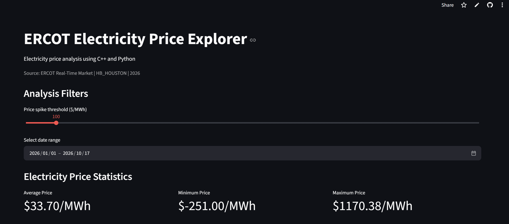

<div align="center">

# ERCOT Electricity Price Explorer

**An interactive dashboard for exploring Texas wholesale electricity prices using C++ and Python.**

[Live Dashboard](https://ercot-electricity-explorer-qmiapptwggeenabuzxjcecf.streamlit.app/) · [Source Code](https://github.com/andrewholder-eng/ercot-electricity-explorer) · [Data Source](https://www.ercot.com/mktinfo/prices)

</div>

## About the Project

The ERCOT Electricity Price Explorer analyzes historical Real-Time Market electricity prices for the **Houston trading hub (`HB_HOUSTON`)**. It combines a **C++ analysis backend** with a **Python/Streamlit dashboard** to help users explore price trends, compare dates, and identify unusually high wholesale electricity prices.

The current dataset covers **January through October 17, 2026**, using 15-minute settlement price observations. The dashboard is intended for educational data analysis; wholesale prices are not the same as residential electricity rates.

## Built With

- **C++17:** Reads CSV files, calculates summary statistics and hourly/daily averages, and detects price spikes
- **Python:** Connects the C++ backend to the web application
- **Streamlit:** Interactive dashboard and input controls
- **Pandas:** Data loading, filtering, and analysis
- **Plotly:** Interactive charts and visualizations
- **Git & GitHub:** Version control and collaboration

## Features

- Select a date range to analyze available historical data
- Adjust the price threshold used to identify spikes
- View average, minimum, and maximum electricity prices
- Compare hourly and daily average prices
- Explore the price distribution and 15-minute price timeline
- View the 10 highest prices in the selected period

<!-- Add a screenshot after saving it to images/dashboard.png:

-->

## How It Works

1. Historical ERCOT settlement prices are converted into CSV files.
2. The user chooses a date range and price spike threshold in Streamlit.
3. Python runs the C++ executable with those selections as command-line arguments.
4. C++ filters the observations and outputs summary statistics, hourly and daily averages, and spike records.
5. Pandas loads the results, and Streamlit/Plotly displays the graphs and tables.

Each analysis uses its own temporary folder for C++ output, so different users do not overwrite one another's results.

## Getting Started

### Prerequisites

- Python 3
- A C++17-compatible `g++` compiler

### Run Locally

1. Clone the repository:

   ```bash
   git clone https://github.com/andrewholder-eng/ercot-electricity-explorer.git
   cd ercot-electricity-explorer
   ```

2. Install the Python dependencies:

   ```bash
   python -m pip install -r requirements.txt
   ```

3. Start the dashboard:

   ```bash
   python -m streamlit run dashboard/app.py
   ```

The app compiles `cpp/main.cpp` automatically if the executable is not already present. Open the local URL shown by Streamlit (usually `http://localhost:8501`).

## Data Source

- **Provider:** Electric Reliability Council of Texas (ERCOT)
- **Dataset:** Historical Real-Time Market Load Zone and Hub Settlement Point Prices
- **Location:** `HB_HOUSTON`
- **Coverage:** January 1–October 17, 2026 (October is partial)
- **Resolution:** 15-minute settlement intervals
- **Units:** USD per megawatt-hour ($/MWh)
- **Official source:** [ERCOT Market Prices](https://www.ercot.com/mktinfo/prices)

The repository's `data/prices.csv` is used for the C++ calculations, while `data/prices_detailed.csv` preserves settlement-interval details for the timeline. Negative prices may occur in wholesale electricity markets and are retained in the analysis.

## Contributors

This project is a collaboration between students working on software development and electricity market research.

| Contributor | Background | Contributions |
| --- | --- | --- |
| **[Andrew Holder](https://github.com/andrewholder-eng)** | Texas A&M University — Engineering | Primarily developed the **C++ backend**, including CSV processing, price statistics, hourly/daily averages, and spike detection; collaborated on integration, testing, and deployment. |
| **Purdue collaborator — name/GitHub to add** | Purdue University — Electrical and Computer Engineering | Primarily developed the **Python portion**, including the Streamlit interface, data handling, and visualizations; collaborated on C++/Python integration, testing, and deployment. |
| **Economics collaborator — name/GitHub to add** | Economics | Researching ERCOT market structure, historical price movements, and potential economic explanations for price spikes. |

*Update the contributor details to reflect each person's completed work before publishing the final project description.*

## Economic Analysis

Economic research is in progress. Planned topics include how wholesale electricity prices respond to supply and demand, how prices vary across hours and months, and the market conditions associated with selected high-price events. Findings will be added here with data and source references once reviewed.

## Project Status

- [x] C++ data analysis backend
- [x] Streamlit dashboard and visualizations
- [x] Integration of historical ERCOT price data
- [x] Cross-check of core statistics against Python calculations
- [x] Public Streamlit deployment
- [ ] Add reviewed economic findings and citations
- [ ] Add dashboard screenshots

## Acknowledgments

- [ERCOT](https://www.ercot.com/) for publishing historical electricity market data
- [Streamlit](https://streamlit.io/) for the dashboard framework
- [Best README Template](https://github.com/othneildrew/Best-README-Template) for layout inspiration

---

*Independent educational project; not affiliated with or endorsed by ERCOT.*
